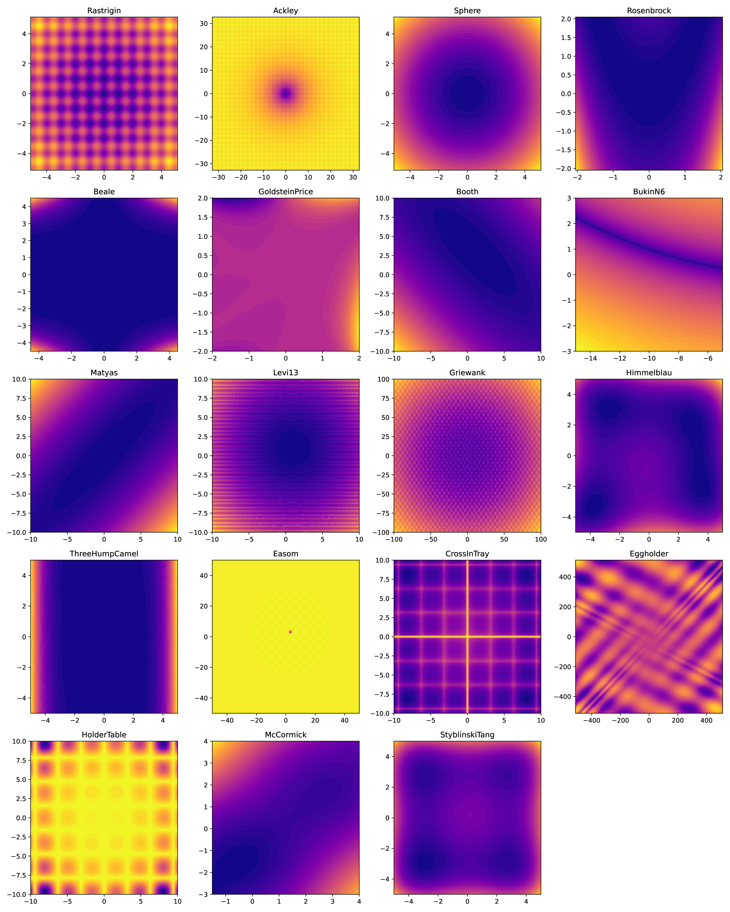
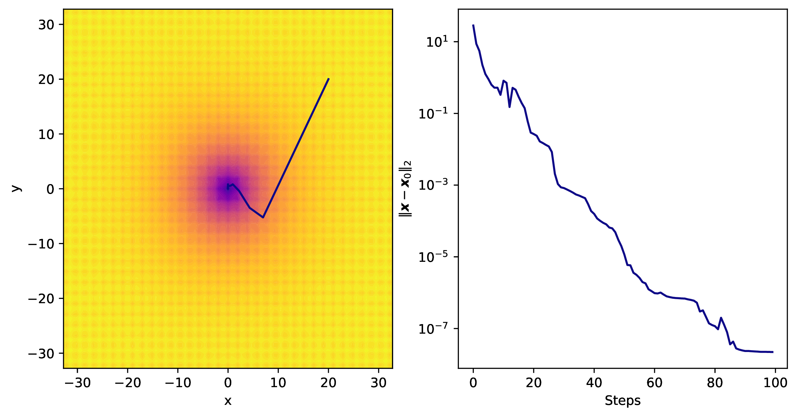
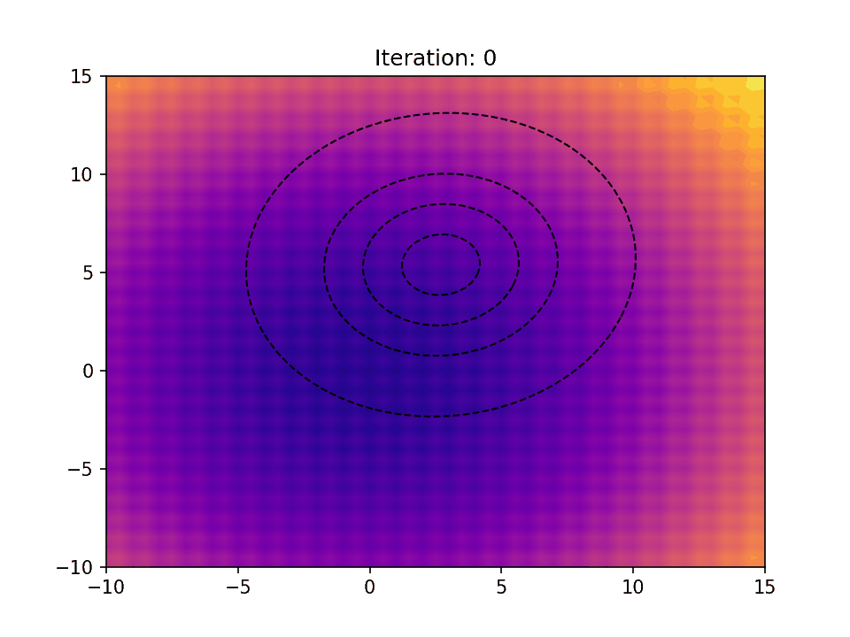
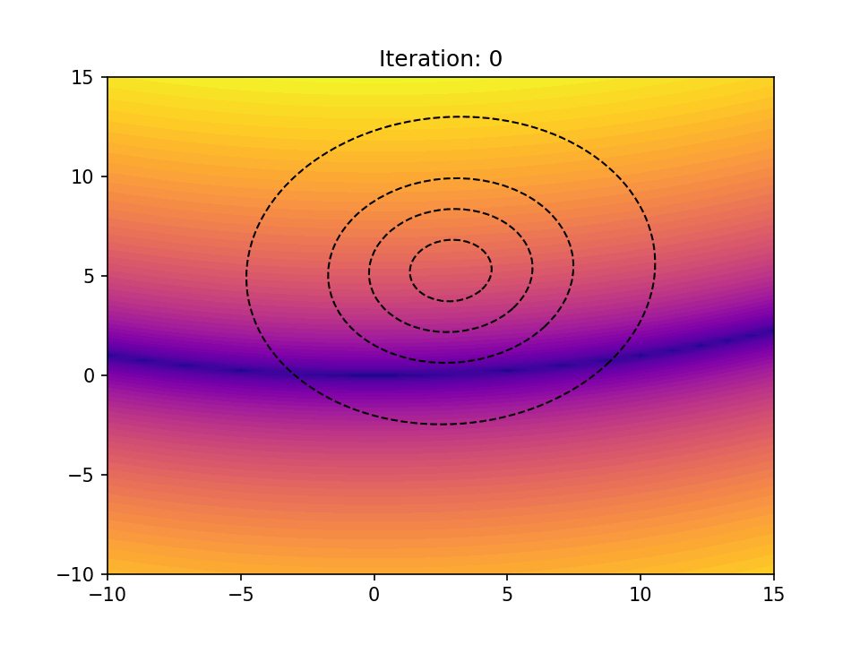
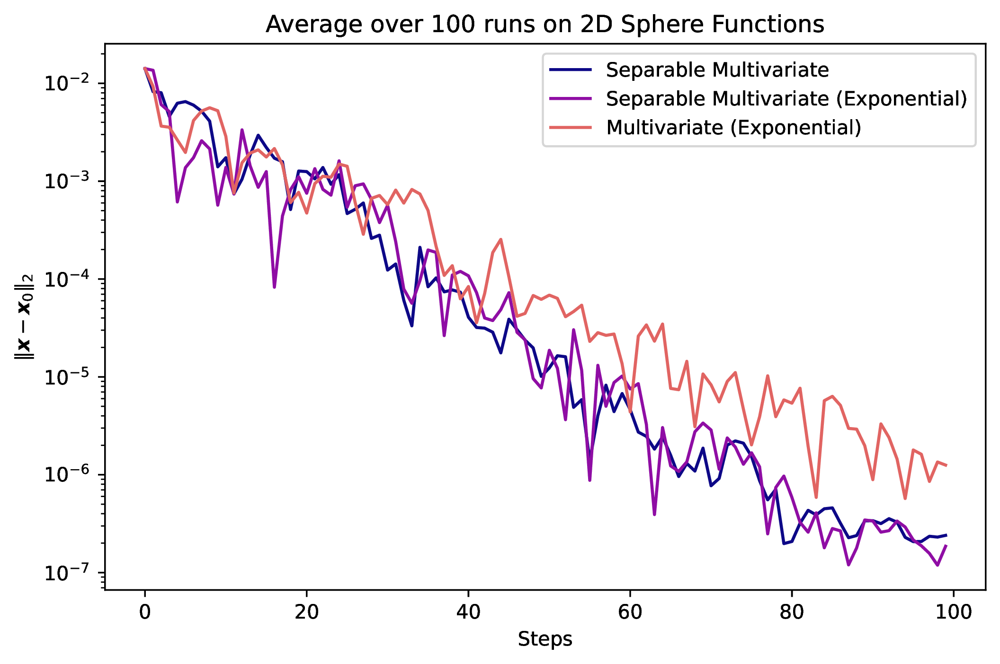
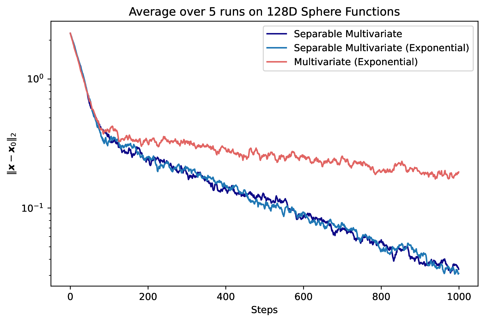
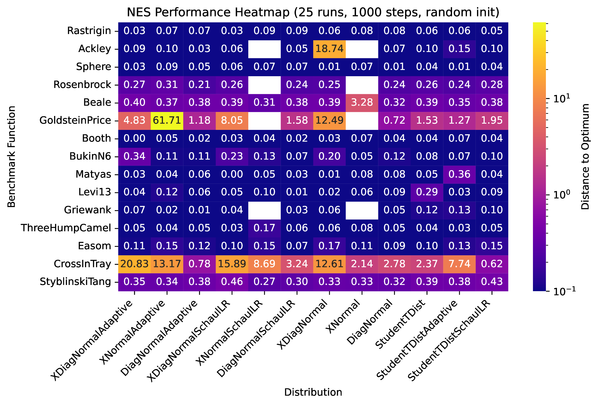

# NES - Natural Evolution Strategies

The code and this file can be found on the repository: [https://git.uibk.ac.at/csaz6745/nes](https://git.uibk.ac.at/csaz6745/nes).

Natural Evolution Strategies are a class of evolutionary optimization strategies (ES) that optimize the parameters of distributions to find optima in a (high-dimensional) potential landscape. These strategies combine the use of stochastic gradients with further distribution-specific properties like the Fisher information matrix to produce more reliable results. Since the choice of distribution and its parametrization have an impact on the performance of the specific algorithm, a comparison becomes exceedingly interesting.

The entire project is based on a summary of the method from [Wierstra et al. (2008)](https://ieeexplore.ieee.org/document/4631255).

## Theoretical Background

The general idea of NES is to choose parameters ($\theta_i$) for a more or less problem-specific distribution into a parameter vector

$$
\boldsymbol{\theta} = (\theta_1, \theta_2, \dots, \theta_n)^T
$$

that is able to resolve the potential space. Commonly, this is done by using a distribution centered around $\boldsymbol{0}$ in combination with a mean shift of appropriate dimension $d$:

$$
\boldsymbol{\mu} = (\mu_1, \mu_2, \dots, \mu_d)^T
$$

For a separable Normal distribution in 3 dimensions, we define:

$$
\pi(\mathbf{z} \mid \boldsymbol{\theta}) = \mathcal{N}(\mathbf{z}; \boldsymbol{\mu}, \operatorname{diag}(\boldsymbol{\sigma}^2)) = \prod_{i=1}^3 \frac{1}{\sqrt{2\pi\sigma_i^2}} \exp\left(-\frac{(z_i - \mu_i)^2}{2\sigma_i^2}\right)
$$

This parametrization therefore results in the following free parameters:

$$
\boldsymbol{\theta} = (\mu_1, \mu_2, \mu_3, \sigma_1, \sigma_2, \sigma_3)^T
$$

Using this parametrization, it becomes viable to compute the stochastic gradient in the parameter space based on samples evaluated on the potential surface. Specifically, one simply takes the gradient of the probability density function (PDF) with respect to the parameters:

$$
\nabla_{\boldsymbol{\theta}} J(\boldsymbol{\theta}) \approx \frac{1}{\lambda} \sum_{k=1}^{\lambda} f(\mathbf{z}_k)\, \nabla_{\boldsymbol{\theta}} \log \pi(\mathbf{z}_k \mid \boldsymbol{\theta})
$$

where $\pi(\mathbf{z}_k \mid \boldsymbol{\theta})$ is the PDF at sample $\mathbf{z}_k$, and $f(\mathbf{z}_k)$ is its evaluated fitness (i.e., potential). This is the log-likelihood trick, which enables Monte Carlo–based estimation of the expected gradient.

Specializing this expression for the 3D separable Gaussian case, we obtain the following analytic gradient of the log-likelihood:

$$
\nabla_{\mu_i} \log \pi(\mathbf{z}_k \mid \boldsymbol{\theta}) = \frac{z_{k,i} - \mu_i}{\sigma_i^2}, \quad \nabla_{\sigma_i} \log \pi(\mathbf{z}_k \mid \boldsymbol{\theta}) = \frac{(z_{k,i} - \mu_i)^2}{\sigma_i^3} - \frac{1}{\sigma_i}
$$

Therefore, the full gradient vector for a single sample $\mathbf{z}_k$ is:

$$
\nabla_{\boldsymbol{\theta}} \log \pi(\mathbf{z}_k \mid \boldsymbol{\theta}) =
\begin{bmatrix}
\frac{z_{k,1}-\mu_1}{\sigma_1^2} \\
\frac{z_{k,2}-\mu_2}{\sigma_2^2} \\
\frac{z_{k,3}-\mu_3}{\sigma_3^2} \\
\frac{(z_{k,1}-\mu_1)^2}{\sigma_1^3} - \frac{1}{\sigma_1} \\
\frac{(z_{k,2}-\mu_2)^2}{\sigma_2^3} - \frac{1}{\sigma_2} \\
\frac{(z_{k,3}-\mu_3)^2}{\sigma_3^3} - \frac{1}{\sigma_3}
\end{bmatrix}
$$

This expression can be plugged into the Monte Carlo estimator to compute the stochastic gradient update in NES.

The well-understood issue with simply applying this gradient in a gradient descent manner is the inverse relation of the mean update and the covariance:

$$
\nabla_{\mu_i} J(\boldsymbol{\theta}) \propto \frac{1}{\sigma_i^2}
$$

The result is that the closer the distribution zeros in on the minimum, reducing variance in the process, the more volatile the mean becomes, preventing high accuracy.

To address this fundamental limitation, Natural Evolution Strategies (NES) introduces a principled approach by leveraging the structure of the underlying distribution. Specifically, NES introduces the Fisher information matrix as a correction (essentially preconditioner) to the update

$$
\widetilde{\nabla}_{\boldsymbol{\theta}} J(\boldsymbol{\theta}) := \mathbf{F}^{-1}(\boldsymbol{\theta}) \, \nabla_{\boldsymbol{\theta}} J(\boldsymbol{\theta})
$$

This ensures invariance under the parametrization and allows for scale invariance between different parameters.

The general Fisher matrix for a distribution $\pi(\mathbf{z} \mid \boldsymbol{\theta})$ is given by:

$$
\mathbf{F}(\boldsymbol{\theta}) = \mathbb{E}_{\mathbf{z} \sim \pi(\cdot \mid \boldsymbol{\theta})} \left[ \nabla_{\boldsymbol{\theta}} \log \pi(\mathbf{z} \mid \boldsymbol{\theta}) \, \nabla_{\boldsymbol{\theta}} \log \pi(\mathbf{z} \mid \boldsymbol{\theta})^T \right]
$$

Generally, this is done stochastically using a similar approach as for the stochastic gradient.

For specific cases (multivariate normals), however, there exists an acceptable closed-form solution provided by the equation:

$$
\mathcal{I}_{m,n} = \frac{\partial \boldsymbol{\mu}^{\mathrm{T}}}{\partial \theta_m}
\boldsymbol{\Sigma}^{-1} \frac{\partial \boldsymbol{\mu}}{\partial \theta_n} + \frac{1}{2} \, \mathrm{tr} \left( \boldsymbol{\Sigma}^{-1} \frac{\partial \boldsymbol{\Sigma}}{\partial \theta_m} \boldsymbol{\Sigma}^{-1} \frac{\partial \boldsymbol{\Sigma}}{\partial \theta_n} \right)
$$

In the case of our separable Gaussian distribution, we can attain the Fisher matrix analytically:

$$
\mathbf{F}_{\mu_i, \mu_i} = \frac{1}{\sigma_i^2} \hspace{20px} \mathbf{F}_{\sigma_i, \sigma_i} =
$$

Therefore, the natural gradient corrects the problematic inverse scaling observed in the standard gradient, yielding updates like:

$$
\widetilde{\nabla}_{\mu_i} J(\boldsymbol{\theta}) \propto \sigma_i^2 \cdot \nabla_{\mu_i} J(\boldsymbol{\theta}) \propto f(\mathbf{z}_k) (z_{k,i} - \mu_i)
$$

which are no longer destabilized by small $\sigma_i$.

This allows for the usage of a wide variety of functions to better fit the circumstance.

## Subclasses of NES

Normal distributions are a common choice for stochastic gradient methods, making up a large part of the implementations. Especially exponential representations are common due to the reduction of complexity in the calculation. Exponential (xNES) and non-exponential parametrizations are implemented for this project, allowing the comparison between the two strategies based on stability and performance. This group is also split further into separable (SNES) and full representations since advantages, especially from a computational point of view, can vary quite significantly. Heavy-tailed distributions represented by the Students-t class of distributions are also represented as they can allow for avoidance of local minima.

To appropriately assess the performance depending on the following distributions and parametrizations were implemented.

### Separable Multivariate Normal

The separable multivariate normal distribution is characterized by its diagonal covariance matrix, simplifying computations and allowing for closed-form solutions for gradients and Fisher matrices.

#### Parametrization

The distribution is parameterized by:

$$
\boldsymbol{\theta} = (\mu_1, \mu_2, \dots, \mu_d, \sigma_1^2, \sigma_2^2, \dots, \sigma_d^2)^T
$$

where $\mu_i$ represents the mean for dimension $i$, and $\sigma_i^2$ represents the variance for dimension $i$.

#### Gradients

The gradients of the log-likelihood with respect to the parameters are:

$$
\nabla_{\mu_i} \log \pi(\mathbf{z}_k \mid \boldsymbol{\theta}) = \frac{z_{k,i} - \mu_i}{\sigma_i^2}, \quad \nabla_{\sigma_i^2} \log \pi(\mathbf{z}_k \mid \boldsymbol{\theta}) = \frac{(z_{k,i} - \mu_i)^2}{2\sigma_i^4} - \frac{1}{2\sigma_i^2}
$$

#### Fisher Matrix

The Fisher matrix for the separable multivariate normal distribution is given analytically as:

$$
\mathbf{F}_{\mu_i, \mu_i} = \frac{1}{\sigma_i^2}, \quad \mathbf{F}_{\sigma_i^2, \sigma_i^2} = \frac{1}{2\sigma_i^4}
$$

The separable multivariate normal exponential representation uses logarithmic parameters for the covariance, simplifying updates and ensuring positive variances.

#### Parametrization

The distribution is parameterized by:

$$
\boldsymbol{\theta} = (\mu_1, \mu_2, \dots, \mu_d, \ln(\sigma_1), \ln(\sigma_2), \dots, \ln(\sigma_d))^T
$$

where $\mu_i$ represents the mean for dimension $i$, and $\ln(\sigma_i)$ represents the logarithm of the standard deviation for dimension $i$.

#### Gradients

The gradients of the log-likelihood with respect to the parameters are:

$$
\nabla_{\mu_i} \log \pi(\mathbf{z}_k \mid \boldsymbol{\theta}) = \frac{z_{k,i} - \mu_i}{\sigma_i^2}, \quad \nabla_{\ln(\sigma_i)} \log \pi(\mathbf{z}_k \mid \boldsymbol{\theta}) = \frac{(z_{k,i} - \mu_i)^2}{\sigma_i^2} - 1
$$

#### Fisher Matrix

The Fisher matrix for the separable multivariate normal exponential representation is given analytically as:

$$
\mathbf{F}_{\mu_i, \mu_i} = \sigma_i^2, \quad \mathbf{F}_{\ln(\sigma_i), \ln(\sigma_i)} = 2
$$

### Students-T Exponential Representation (SNES)

The Students-T distribution is a heavy-tailed distribution that allows for sampling points further from the mean, making it suitable for escaping local minima.

#### Parametrization

The distribution is parameterized by:

$$
\boldsymbol{\theta} = (\mu_1, \mu_2, \dots, \mu_d, \ln(\sigma_1), \ln(\sigma_2), \dots, \ln(\sigma_d), \ln(\nu))^T
$$

where $\mu_i$ represents the mean for dimension $i$, $\ln(\sigma_i)$ represents the logarithm of the standard deviation for dimension $i$, and $\ln(\nu)$ represents the logarithm of the degrees of freedom.

#### Gradients

The gradients of the log-likelihood with respect to the parameters are:

$$
\nabla_{\mu_i} \log \pi(\mathbf{z}_k \mid \boldsymbol{\theta}) = \frac{(\nu + d) z_i}{(\nu + \|z\|^2) \sigma_i}, \quad \nabla_{\ln(\sigma_i)} \log \pi(\mathbf{z}_k \mid \boldsymbol{\theta}) = \frac{(\nu + d) z_i^2}{\nu + \|z\|^2} - 1
$$

$$
\nabla_{\ln(\nu)} \log \pi(\mathbf{z}_k \mid \boldsymbol{\theta}) = \nu \left( \frac{1}{2} \psi\left(\frac{\nu + d}{2}\right) - \frac{1}{2} \psi\left(\frac{\nu}{2}\right) - \frac{1}{2} \ln\left(1 + \frac{\|z\|^2}{\nu}\right) - \frac{d}{2\nu} + \frac{(\nu + d) \|z\|^2}{2(\nu^2 + \nu \|z\|^2)} \right)
$$

where $z_i = \frac{z_{k,i} - \mu_i}{\sigma_i}$ and $\|z\|^2 = \sum_{i=1}^d z_i^2$.

#### Fisher Matrix

The Fisher matrix for the Students-T distribution is computed numerically due to the complexity of the closed-form solution. However, the inverse Fisher matrix diagonal can be approximated as:

$$
\mathbf{F}_{\mu_i, \mu_i}^{-1} \approx \sigma_i^2, \quad \mathbf{F}_{\ln(\sigma_i), \ln(\sigma_i)}^{-1} \approx 2, \quad \mathbf{F}_{\ln(\nu), \ln(\nu)}^{-1} \approx \frac{1}{\text{Var}(\nabla_{\ln(\nu)} \log \pi)}
$$

### Multivariate Normal

The multivariate normal distribution uses a full covariance matrix, allowing for more flexible modeling of dependencies between dimensions.

#### Parametrization

The distribution is parameterized by:

$$
\boldsymbol{\theta} = (\boldsymbol{\mu}, \mathbf{A})^T
$$

where $\boldsymbol{\mu}$ represents the mean vector, and $\mathbf{A}$ is the Cholesky decomposition of the covariance matrix $\mathbf{\Sigma}$ such that $\mathbf{\Sigma} = \mathbf{A}^T \mathbf{A}$.

#### Gradients

The gradients of the log-likelihood with respect to the parameters are:

$$
\nabla_{\boldsymbol{\mu}} \log \pi(\mathbf{z}_k \mid \boldsymbol{\theta}) = \mathbf{\Sigma}^{-1} (\mathbf{z}_k - \boldsymbol{\mu}),
$$

$$
\nabla_{\mathbf{A}} \log \pi(\mathbf{z}_k \mid \boldsymbol{\theta}) = \mathbf{A} \left(-\frac{1}{2} \mathbf{\Sigma}^{-1} + \frac{1}{2} \mathbf{\Sigma}^{-1} (\mathbf{z}_k - \boldsymbol{\mu})(\mathbf{z}_k - \boldsymbol{\mu})^T \mathbf{\Sigma}^{-1} \right).
$$

#### Fisher Matrix

The Fisher matrix for the multivariate normal distribution is computed numerically due to the complexity of the closed-form solution. However, it can be approximated using sample-based methods.

### Multivariate Normal Exponential Representations (xNES)

The multivariate normal exponential representation uses matrix exponential updates for the covariance, ensuring positive-definiteness and simplifying parameter updates.

#### Parametrization

The distribution is parameterized by:

$$
\boldsymbol{\theta} = (\boldsymbol{\mu}, \mathbf{A})^T
$$

where $\boldsymbol{\mu}$ represents the mean vector, and $\mathbf{A}$ is the Cholesky decomposition of the covariance matrix $\mathbf{\Sigma}$ such that $\mathbf{\Sigma} = \mathbf{A}^T \mathbf{A}$.

#### Gradients

The gradients of the log-likelihood with respect to the parameters are:

$$
\nabla_{\boldsymbol{\mu}} \log \pi(\mathbf{z}_k \mid \boldsymbol{\theta}) = \mathbf{A} (\mathbf{z}_k - \boldsymbol{\mu}),
$$

$$
\nabla_{\mathbf{A}} \log \pi(\mathbf{z}_k \mid \boldsymbol{\theta}) = \frac{1}{2} \mathbf{A} \left[ \mathbf{A}^{-1} (\mathbf{z}_k - \boldsymbol{\mu})(\mathbf{z}_k - \boldsymbol{\mu})^T \mathbf{A}^{-T} - \mathbf{I} \right].
$$

#### Fisher Matrix

The Fisher matrix for the multivariate normal exponential representation is computed numerically due to the complexity of the closed-form solution. However, it can be approximated using sample-based methods.

## Learning Rates

Despite seeming similar to many other optimization strategies, we cannot use common optimization strategies around learning rates. Since there exists essentially a feedback loop between the distribution and sample fitnesses, it becomes quite fragile to adaptively change step sizes:

In the case this introduces additional step size consistently, we get recursive instability. In the case of essentially overdamping, we get premature convergence.

Therefore, we must choose the learning rates very carefully. Generally, we cannot touch the learning rate of the means at all, making parameter-specific learning rates necessary. This already makes usual approaches for avoiding local minima impossible: Momentum-based approaches and adaptive increases/decreases based on performance become impossible for the means.

Commonly used are, however, approaches scaling or even resetting the variances at certain stages of the process. This essentially equates to heat-based approaches that repetitively attempt to avoid local minima by temporarily increasing the variance, potentially allowing an escape from the local minimum.

An entirely different approach is provided by the use of heavy-tailed functions such as Cauchy (or more generally Students-T) distributions that by default sample more points at further out points. If this successfully lands outside the local minimum, it allows a so-called hop to a new location by being the largest contributor to the gradient by magnitudes.

The learning rates for the parameters can be adjusted based on different strategies that were found to work:

1. **Constant Learning Rates**: Heuristically chosen rates, such as:
   - $\mu$ rates: $1$
   - $\mathbf{A}$ rates: $\frac{3 + \log(d)}{5 \sqrt{d}}$ ([Schaul et. al. 2011](https://www.researchgate.net/publication/220740506_High_Dimensions_and_Heavy_Tails_for_Natural_Evolution_Strategies))
   - Works extremely well for up to 32 Dimensions.


2. **Adaptive Learning Rates**: KL-based rates with EMA stabilization:
   - Covariance rates are adjusted dynamically using a KL budget and exponential moving average (EMA) of gradient norms.
   - This rescaling can cause numerical instability in a few cases.
   - This tends to perform better for higher dimensional problems.
   - $\delta\theta \;\mapsto\; r\,\delta\theta$ with $r = \sqrt{\frac{2\,\text{klbudget}}{\delta\theta^\top F\,\delta\theta}}$ ([Slide Set (Page 6)](https://people.eecs.berkeley.edu/~pabbeel/cs287-fa09/lecture-notes/lecture20-2pp.pdf?utm_source=chatgpt.com))

Generally, both of these perform quite similarly for low ($\approx 30$) dimensions, while for higher dimensional problems, the KL-based approach dominates by far.

## Implementation

The code can be found under the public [GitLab Repository](https://git.uibk.ac.at/csaz6745/nes).

Essentially, the implementation consists of 3 components: **Models**, **Distributions**, and **Optimizers**. Optimizers encapsulate the iteration logic and are not strictly necessary for usage, as direct access to models and distributions is also possible. The latter are implemented as abstract base classes, allowing for easy and safe addition of new variants.

Models are implemented in a way to support Python and NumPy functions/operators, enabling intuitive and expressive numerical model definitions. The backend utilizes corresponding NumPy operators, reducing overhead to simple object function calls per algebraic operation.

While distributions are implemented as presented above, we need to discuss the models available for testing.

### Models

Models define a callable objective function $f: \mathbb{R}^d \to \mathbb{R}$, and expose bounds for plotting and optimization.

For benchmarking the performance of different implementations, a variety of well-known 2D test functions are included, such as:

* Sphere
* Rastrigin
* Ackley
* Rosenbrock
* Eggholder
* And more

See [`nes.models.benchmarks2D`](https://git.uibk.ac.at/csaz6745/nes/-/tree/main/nes/models/benchmarks2D.py) for available test functions but here are their visualizations since its nice to look at:



### Example Usage

A minimal working example using NES without the optimizer class:

```python
from nes.models.benchmarks2D import Sphere
from nes.dists import XDiagNormal
import numpy as np

model = Sphere.model()
dist = XDiagNormal.from_model(model)
for _ in range(100):
    samples = dist.get_samples(100)
    fitness = model.evaluate_samples(samples)
    dist.param_variation(samples, fitness)
```

This loop demonstrates the raw interaction between model and distribution—sample, evaluate, update—representing the core NES update rule. For further usage please refer to the  [`example.ipynb`](https://git.uibk.ac.at/csaz6745/nes/-/tree/main/res/example.ipynb)

## Performance

An example optimization of the algorithm (using Ackley function and diagonal covariance with exponential parametrization) can be seen below:



As can be seen we can get initial overshoots as well as small sections of more stagnant steps. Still the optimization is successful and finds the global optimum (minimum), with what is essentially exponential convergence.

Additionally, some animations are provided here to better show the distribution adapt to the search landscape:





### Dimensional Performance

To assess the differences between different distributions and specifically learning rates, we perform ensemble optimizations for two separate sphere functions in different dimensions. For this test, the diagonal multivariate normals use a KL-budget learning rate, while the full covariance approach uses the heuristic learning rate.

Starting with a low-dimensional case, we can see exponential convergence:



The different learning rates do not yet make a notable difference. In opposition, we get different performance for different learning rates in higher dimensional problems:




### Model-Distribution Compatibility

To assess usability of the different distributions over a variety of models, a compatibility matrix is created using an ensemble of optimization attempts with random start values over the bounds of the trial functions. Termination criteria are errors (`np.nan`) or convergence to within tolerance. This allows for the generation of the following visualization:



The image shows the averaged Euclidean distance from the optimum after termination for the attempts. Some distribution-function combinations clearly outperform others. However, there exists no clear distribution candidate outperforming all others. This is simply a basic property of optimization problems as finding a general optimization algorithm for all problems becomes impossible based on the [*No Free Lunch Theorems for Optimization* (1997)](https://ieeexplore.ieee.org/document/585893).

This still shows an applicability of the algorithms for a wide variety of functions and optimization problems, despite the barebones implementation.

Specifically, it is possible to see that the premature convergence in local minima remains a significant problem as the average distances suggest. For Rastrigin and Ackley that offer local minima, we can extract information on how likely a convergence to the global minimum is by the mean distance. The higher the mean distance, the more likely the convergence reaches only a local minimum.

## Summary

In the end, these algorithms offer an approach for a wide variety of problems and perform adequately. While there are still issues, these might be alleviated by more sophisticated implementations using more complex methods such as restarts, heat-based expansions, or advanced learning rates.

## Additional Reading

* **Wierstra et al. (2014)** – *Natural Evolution Strategies*. *Journal of Machine Learning Research*
  Extended and cleaned-up version including theory and applications.
  [PDF](https://www.jmlr.org/papers/volume15/wierstra14a/wierstra14a.pdf)

* **Wierstra et al. (2008)** – *Natural Evolution Strategies*. CEC 2008
  Introduces NES with natural gradients and fitness shaping.
  [PDF](https://people.idsia.ch/~juergen/nes2008.pdf), [Wikipedia](https://en.wikipedia.org/wiki/Natural_evolution_strategy)

* **Schaul et al. (2011)** – *High Dimensions and Heavy Tails for Natural Evolution Strategies*. GECCO
  Introduces heuristic learning rates for NES and the use of heavy-tailed distributions.
  [PDF](https://www.idsia.ch/~juergen/gecco2011snes.pdf)

* **Schaul (2012)** – *Natural Evolution Strategies Converge on Sphere Functions*. GECCO
  Proves exponential convergence for NES on quadratic landscapes.
  [PDF](https://schaul.site44.com/publications/nesproof.pdf), [arXiv](https://arxiv.org/abs/1106.4487)

* **Wikipedia** – *Natural Evolution Strategies*
  General overview and pointers to NES variants.
  [Article](https://en.wikipedia.org/wiki/Natural_evolution_strategy)
